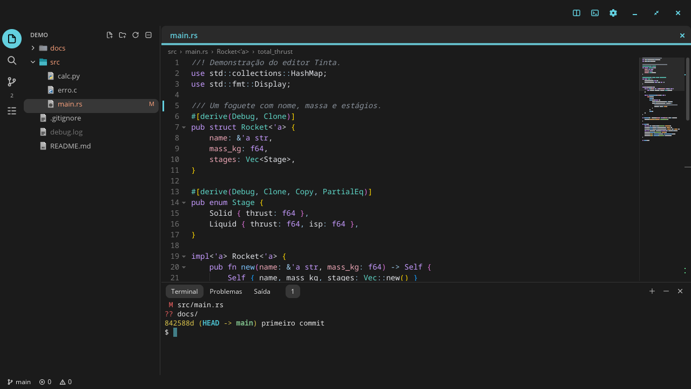
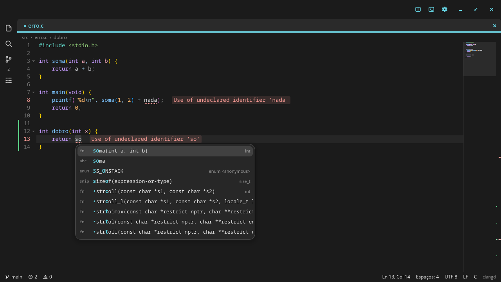
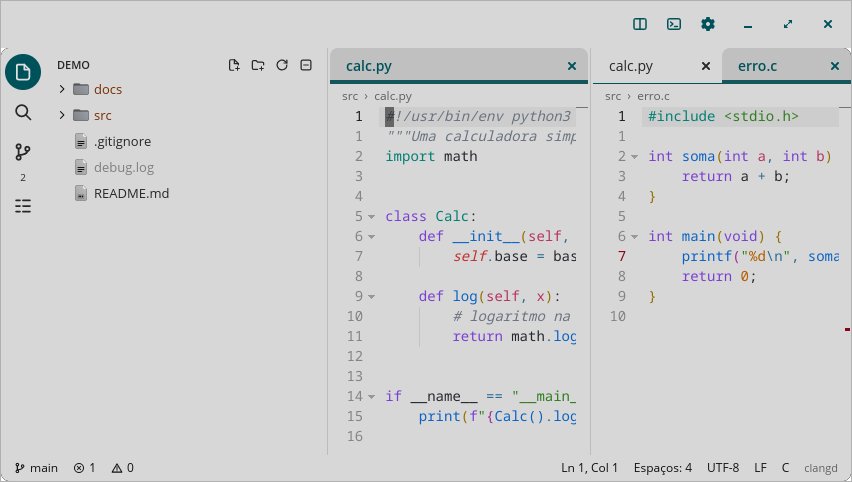

# Tinta

Um editor de código para o desktop COSMIC, escrito em Rust com o libcosmic. Tem a cara dos
aplicativos do COSMIC (segue o tema, a cor de destaque e os cantos do sistema) e faz o que se
espera de um VS Code ou de um Sublime Text.







## O que ele faz

**Edição**

- Múltiplos cursores: `Ctrl+D` na próxima ocorrência, `Ctrl+Shift+L` em todas, `Alt+clique`,
  `Ctrl+Alt+↑/↓`, seleção em coluna com `Shift+Alt+arrastar` ou o botão do meio
- Fecha parênteses e aspas sozinho, digita por cima do que fechou, envolve a seleção
- Indentação automática, detecção de espaços ou tabs, comentar linha e bloco
- Mover, duplicar, juntar, ordenar, inverter, embaralhar e tirar duplicatas de linhas
- Maiúsculas, minúsculas, `snake_case`, `camelCase`, `PascalCase`, `kebab-case`
- Expandir a seleção (palavra → dentro dos parênteses → com os parênteses → linha → tudo)
- Desfazer e refazer por agrupamento, como nos editores que você já conhece
- Snippets com pontos de parada, embutidos para as linguagens mais comuns e seus próprios em JSON
- Teclas mortas e métodos de entrada: `á`, `ç`, `ã` no ABNT2 funcionam, CJK também

**Visualização**

- Destaque de sintaxe para 220 gramáticas, incremental: digitar no meio de um arquivo de
  300 mil linhas reprocessa só o que mudou
- 13 temas de cores, além do COSMIC, que acompanha o claro e o escuro do sistema
- Parênteses coloridos por profundidade, ignorando strings e comentários
- Minimapa, guias de indentação, rolagem aderente, réguas, espaços visíveis
- Dobra de código, quebra de linha, números de linha absolutos ou relativos
- Destaque do par do parêntese e das ocorrências da palavra sob o cursor
- Breadcrumbs, divisão em vários grupos, modo zen, tela cheia
- Pré-visualização de Markdown ao lado do texto

**Navegação**

- Paleta de comandos (`Ctrl+Shift+P`) com busca aproximada e todos os comandos
- `Ctrl+P` para arquivos; digitando `>` vira comandos, `:` vira linha, `@` vira símbolo
- Voltar e avançar, marcadores, próximo problema, próxima alteração do git
- Estrutura do arquivo na barra lateral

**Busca**

- Localizar e substituir com expressão regular, palavra inteira, maiúsculas, dentro da seleção
- Busca na pasta inteira, respeitando o `.gitignore`, com filtros de arquivos e substituição

**Inteligência de código (LSP)**

Usa os servidores de linguagem que estiverem instalados, sem configuração: rust-analyzer, clangd,
pyright, gopls, typescript-language-server, lua-language-server e os de mais de vinte outras
linguagens.

- Sugestões ao digitar, misturadas com palavras do arquivo e snippets
- Informações ao passar o mouse, dicas de parâmetros
- Ir para definição, declaração, implementação e tipo; localizar referências
- Renomear símbolo em todos os arquivos, formatar, correções rápidas
- Problemas sublinhados, com a mensagem no fim da linha e um painel com todos

**Git**

- Marcas na margem e no mapa da barra de rolagem, próxima alteração, reverter um trecho
- Preparar, descartar, commit, push, pull, fetch e troca de branch
- Diff de cada arquivo, histórico, `git blame` na linha atual

**E o resto**

- Terminal integrado (o emulador do Alacritty), com vários terminais, seleção e cores
- Árvore de arquivos com menu de contexto, ícones do tema e cores do git
- Sessão restaurada ao abrir, e texto não salvo guardado entre execuções (o _hot exit_ do VS Code)
- Salvamento atômico, salvar automaticamente, formatar ao salvar, limpar espaços no fim das linhas
- Codificações (UTF-8, UTF-16, Windows-1252, Shift JIS…) e fins de linha detectados e preservados
- Recarrega arquivos que mudaram no disco e pergunta se você tem alterações não salvas
- Abrir arquivos arrastando, ou na linha de comando: `tinta src/main.rs:10:4`
- Interface em português e inglês, conforme o idioma do sistema

## Instalação

```sh
git clone https://github.com/DrakRosmann/cosmic-ext-tinta
cd cosmic-ext-tinta
./install.sh          # instala em ~/.local
```

O `deps.sh` instala o que faltar com `apt`, `dnf` ou `pacman`. Depois é abrir "Tinta" no lançador,
ou rodar `tinta [arquivo ou pasta]`.

Para ter inteligência de código, instale o servidor da sua linguagem: `rustup component add
rust-analyzer`, `dnf install clang-tools-extra` e assim por diante. Ele é encontrado no `PATH`.

## Configuração

Tudo pode ser mudado na janela de configurações (`Ctrl+,`) ou à mão, em `~/.config/tinta/`. O
arquivo é relido ao salvar, sem reiniciar, e aceita comentários e vírgulas sobrando:

```jsonc
// settings.json
{
  "fontFamily": "JetBrains Mono",
  "fontSize": 15,
  "tabSize": 4,
  "wordWrap": false,
  "rulers": [80, 100],
  "formatOnSave": true,
  "syntaxTheme": "COSMIC",
  // Outro servidor para uma linguagem; "command" vazio desliga.
  "lspServers": {
    "python": { "command": "ruff", "args": ["server"] }
  }
}
```

```jsonc
// keybindings.json: "-" libera uma tecla
[
  { "key": "ctrl+shift+n", "command": "file.new" },
  { "key": "ctrl+k ctrl+x", "command": "edit.trimTrailing" },
  { "key": "ctrl+t", "command": "-" }
]
```

```jsonc
// snippets.json, por linguagem
{
  "Rust": [
    { "prefix": "pr", "description": "println", "body": "println!(\"$1\");$0" }
  ]
}
```

A lista completa de atalhos está em `Ctrl+K Ctrl+S`, e os identificadores dos comandos em
[`keymap.rs`](crates/tinta-core/src/keymap.rs).

### Atalhos principais

| Atalho | Faz |
| --- | --- |
| `Ctrl+Shift+P` / `F1` | Paleta de comandos |
| `Ctrl+P` | Ir para arquivo |
| `Ctrl+G` | Ir para linha |
| `Ctrl+Shift+O` | Ir para símbolo |
| `Ctrl+F` / `Ctrl+H` | Localizar / substituir |
| `Ctrl+Shift+F` | Localizar nos arquivos |
| `Ctrl+D` | Próxima ocorrência como outro cursor |
| `Ctrl+Shift+L` | Todas as ocorrências |
| `Alt+↑` / `Alt+↓` | Mover linha |
| `Ctrl+Shift+D` | Duplicar |
| `Ctrl+Shift+K` | Apagar linha |
| `Ctrl+/` ou `Ctrl+;` | Comentar |
| `Ctrl+\` | Dividir o editor |
| `Ctrl+B` | Barra lateral |
| `Ctrl+J` / `` Ctrl+` `` / `Ctrl+'` | Painel / terminal |
| `F12` / `Ctrl+clique` | Ir para definição |
| `F2` | Renomear símbolo |
| `Ctrl+.` | Correção rápida |
| `Ctrl+Espaço` | Sugestões |
| `Alt+Z` | Quebra de linha |
| `Ctrl+Shift+V` | Pré-visualizar Markdown |

## Como é feito

O projeto é dividido para que quase tudo possa ser testado sem abrir janela:

- **`crates/tinta-core`**: o motor, sem nenhuma dependência de interface. Texto em
  [ropey](https://github.com/cessen/ropey), cursores, desfazer, sintaxe sobre as gramáticas do
  [syntect](https://github.com/trishume/syntect), busca, git (pelo comando `git`), cliente LSP,
  snippets, atalhos.
- **`crates/tinta`**: a interface em [libcosmic](https://github.com/pop-os/libcosmic). O texto é um
  widget próprio, desenhado em uma grade de caracteres para repintar sem refazer o layout. O resto
  (abas, menus, paleta, configurações, diálogos) são os widgets do próprio COSMIC.
- **`crates/tinta-vkbd`**: digita em um compositor pelo protocolo de teclado virtual do Wayland,
  para os testes de ponta a ponta.
- **`crates/tinta-xptr`**: ponteiro real e capturas da tela real, para os mesmos testes.

## Testes

```sh
cargo test                                     # núcleo e interface, sem janela
cargo test --release large_file -- --ignored --nocapture   # mede um arquivo de 300 mil linhas
```

Os testes da interface montam a árvore real de widgets e passam por ela eventos de mouse e teclado,
desenhando cada quadro em um renderizador de software. O cliente LSP é testado contra o clangd de
verdade quando ele está instalado.

Para ver o aplicativo rodando, `tests/e2e/run.sh` abre um `cosmic-comp` aninhado, com configuração
própria, e dirige o app por um script que também tira capturas de tela:

```sh
cargo build --workspace
cat > /tmp/passos.txt <<FIM
wait 500
cmd palette.commands
input salvar
shot /tmp/paleta.png
quit
FIM
tests/e2e/run.sh /tmp/passos.txt
```

Os passos estão descritos em [`script.rs`](crates/tinta/src/app/script.rs).

`tests/e2e/pointer.sh` faz o mesmo com um **ponteiro de verdade**: o compositor roda dentro de um
Xwayland próprio, e o `tinta-xptr` move, clica e captura os pixels da tela, sem mexer no cursor do
desktop. Foi assim que apareceram bugs que nenhum outro teste pegava, como clicar num item de menu
fechar o aplicativo.

## Licença

GPL-3.0-only. COSMIC é uma marca registrada da System76; este é um projeto independente.

## O que falta

- Sem depurador (DAP), extensões nem edição remota.
- Sem navegação pelo teclado na árvore de arquivos, e arrastar abas ainda não reordena: use
  `Ctrl+Shift+PgUp` e `Ctrl+Shift+PgDn`.
- A quebra de linha fica desligada em arquivos acima de 4 milhões de caracteres.
