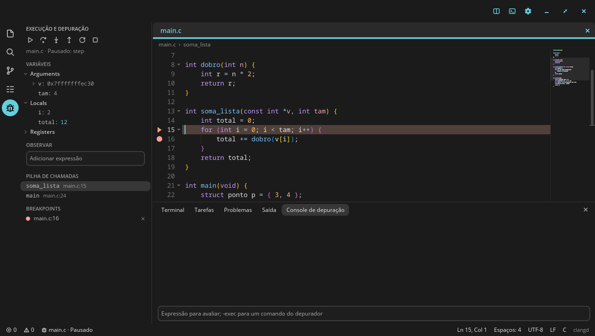
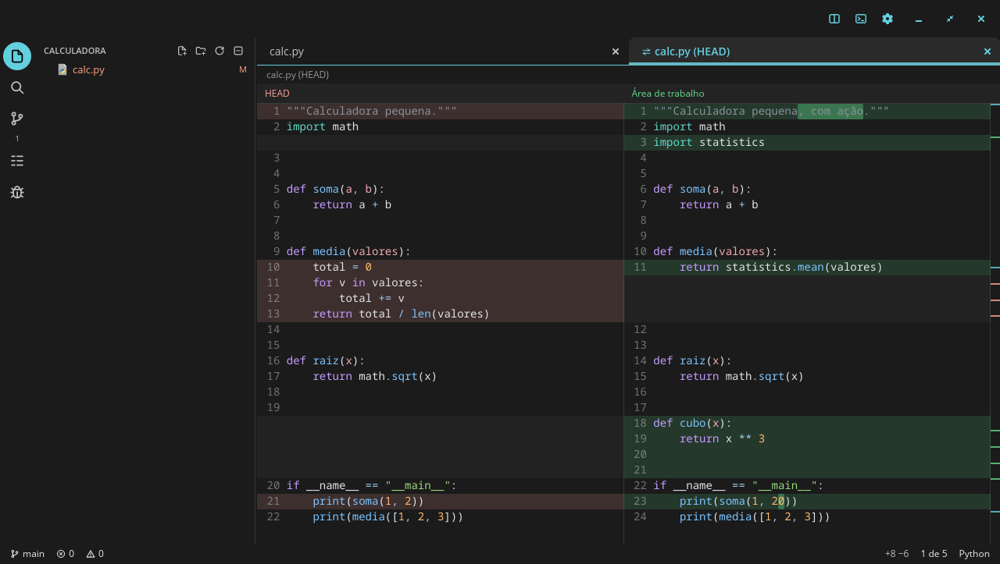

# Tinta

Um editor de código para o desktop COSMIC, escrito em Rust com o libcosmic. Tem a cara dos
aplicativos do COSMIC (segue o tema, a cor de destaque e os cantos do sistema) e faz o que se
espera de um VS Code ou de um Sublime Text.







Há também o [Tinta para GNOME](https://github.com/DrakRosmann/tinta-gnome), com o mesmo motor e a
interface em GTK 4 e libadwaita.

## No COSMIC

- Barra de ícones à esquerda (Explorador, Busca, Controle de versão, Estrutura, Depurar e
  Configurações): fica mesmo com a barra lateral fechada, e clicar no ícone da vista aberta recolhe
  a barra lateral. O ícone do controle de versão mostra quantos arquivos mudaram
- Barra de cima editável: um clique com o botão direito nos botões dela, ou "Editar barra
  superior…" no menu Arquivo, escolhe quais comandos viram botões, de que lado e em que ordem. Cada
  botão mostra o atalho ao passar o mouse
- Cabe numa janela estreita, até 360 px: abaixo de 720 px a barra lateral passa a flutuar sobre o
  texto e sai da frente quando um arquivo abre, e a barra de status fica com o essencial
- Segue o tema, a cor de destaque e a fonte de largura fixa do COSMIC, e muda junto quando eles
  mudam

## O que ele faz

**Edição**

- Múltiplos cursores: `Ctrl+D` na próxima ocorrência, `Ctrl+Shift+L` em todas, `Alt+clique`,
  `Ctrl+Alt+↑/↓`, seleção em coluna com `Shift+Alt+arrastar` ou o botão do meio
- Fecha parênteses e aspas sozinho, digita por cima do que fechou, envolve a seleção
- Indentação automática, detecção de espaços ou tabs, comentar linha e bloco
- Mover, duplicar, juntar, ordenar, inverter, embaralhar e tirar duplicatas de linhas
- Maiúsculas, minúsculas, `snake_case`, `camelCase`, `PascalCase`, `kebab-case`
- Expandir a seleção (palavra → dentro dos parênteses → com os parênteses → linha → tudo)
- Desfazer e refazer por agrupamento, como nos editores que você já conhece
- Snippets com pontos de parada, embutidos para as linguagens mais comuns e seus próprios em JSON
- Teclas mortas e métodos de entrada: `á`, `ç`, `ã` no ABNT2 funcionam, CJK também
- Modo Vim, nas configurações ou em "Alternar modo Vim" (veja abaixo)

**Visualização**

- Destaque de sintaxe para 220 gramáticas, incremental: digitar no meio de um arquivo de
  300 mil linhas reprocessa só o que mudou
- 13 temas de cores, além do COSMIC e do Adwaita (a paleta do GNOME), que acompanham o claro e o
  escuro do sistema
- Parênteses coloridos por profundidade, ignorando strings e comentários
- Minimapa, guias de indentação, rolagem aderente, réguas, espaços visíveis
- Dobra de código, quebra de linha, números de linha absolutos ou relativos, a partir da árvore de
  sintaxe (tree-sitter) em Rust, Python, C, C++, JavaScript, TypeScript, Go, Java, Bash, JSON, HTML
  e CSS, e da indentação nas outras linguagens
- Destaque do par do parêntese e das ocorrências da palavra sob o cursor
- Breadcrumbs, divisão em vários grupos, modo zen, tela cheia
- Pré-visualização de Markdown ao lado do texto

**Navegação**

- Paleta de comandos (`Ctrl+Shift+P`) com busca aproximada e todos os comandos
- `Ctrl+P` para arquivos; digitando `>` vira comandos, `:` vira linha, `@` vira símbolo
- Voltar e avançar, marcadores, próximo problema, próxima alteração do git
- Estrutura do arquivo na barra lateral
- A árvore de arquivos pelo teclado: `Ctrl+Shift+X` vai até ela, as setas andam e abrem pastas
  (`→` abre e entra, `←` fecha e sobe), `Enter` abre, `Espaço` abre e continua na árvore, `F2`
  renomeia, `Delete` manda para a lixeira, uma letra pula para o nome e `Esc` volta ao texto
- As outras listas da barra lateral também, pelo teclado: `↓` no campo de busca ou na mensagem de
  commit desce para a lista, "Mostrar estrutura", "Mostrar controle de versão" e "Mostrar depuração"
  vão direto a ela. As setas andam, `Enter` faz o que o clique faz, `→`/`←` abrem e fecham os
  arquivos da busca e as variáveis, `Espaço` prepara ou tira um arquivo do commit, `F2` muda o valor
  de uma variável e `Esc` volta ao texto

**Busca**

- Localizar e substituir com expressão regular, palavra inteira, maiúsculas, dentro da seleção
- Busca na pasta inteira, respeitando o `.gitignore`, com filtros de arquivos e substituição, que
  alcança todas as ocorrências mesmo quando a lista na tela para em um limite

**Inteligência de código (LSP)**

Usa os servidores de linguagem que estiverem instalados, sem configuração: rust-analyzer, clangd,
pyright, gopls, typescript-language-server, lua-language-server e os de mais de vinte outras
linguagens.

- Sugestões ao digitar, misturadas com palavras do arquivo e snippets
- Informações ao passar o mouse, dicas de parâmetros
- Ir para definição, declaração, implementação e tipo; localizar referências
- Renomear símbolo em todos os arquivos, formatar, correções rápidas
- Problemas sublinhados, com a mensagem no fim da linha e um painel com todos
- Envio parcial: o servidor recebe só o trecho alterado, se aceitar isso
- Sem o servidor da linguagem instalado, um aviso no topo diz qual instalar e copia o comando da
  sua distribuição (Arch, Fedora, Debian e Ubuntu) ou do instalador da linguagem (rustup, npm, go)
- Mesmo sem servidor, e em arquivos sem título, as sugestões trazem as palavras da linguagem: as
  palavras-chave e as funções, tipos e macros que vêm com ela (`println!`, `printf`, `len`,
  `console`…), em Rust, C, C++, Python, JavaScript, TypeScript, Go, Java, C#, Kotlin, Swift, PHP,
  Ruby, Lua, Bash, SQL, HTML e CSS
- Informações ao passar o mouse, dicas de parâmetros
- Ir para definição, declaração, implementação e tipo; localizar referências
- Renomear símbolo em todos os arquivos, formatar, correções rápidas
- Problemas sublinhados, com a mensagem no fim da linha e um painel com todos
- Envio parcial: o servidor recebe só o trecho alterado, se aceitar isso

**Depurador (DAP)**

`F5` compila e roda, e pronto. Usa o `gdb` 14 ou mais novo, o `lldb-dap`, o `debugpy` ou o `dlv`,
os que estiverem instalados. Os testes rodam contra programas de verdade no gdb 15, 16, 17 e 18 e no
debugpy. O gdb 14 é aceito, mas não foi testado, e o lldb-dap e o dlv usam o mesmo código, mas ainda
não foram experimentados.

- Breakpoints com um clique à esquerda dos números de linha ou `F9`, condicionais com `Shift+F9`.
  Acompanham o código quando o arquivo muda e continuam lá da próxima vez
- Variáveis em árvore, com o que mudou desde a última parada em destaque, e expressões observadas.
  Um clique duplo no valor, ou "Mudar valor…" no botão direito, troca o valor com o programa pausado
- `Ctrl+F10` roda até a linha do cursor, sem deixar breakpoint para trás; sem sessão, começa uma e
  vai até lá
- Pilha de chamadas e threads: clicar em um nível mostra aquele nível
- Passar o mouse sobre um nome, com o programa pausado, mostra o valor
- No gdb e no Python (debugpy), o programa ganha um terminal próprio no painel, "Programa": a saída
  aparece ali, e o que se digita ali chega a ele (o `scanf` e o `input` funcionam). Com
  `"console": "internalConsole"` no `launch.json`, a saída volta para o console, sem entrada
- Console que avalia expressões; `-exec` manda um comando ao depurador
- Um erro de compilação aparece no código como qualquer outro, e a sessão não começa

Sem configuração, ele compila o arquivo aberto (C e C++), usa `cargo`, `make` ou `cmake`, ou roda o
arquivo (Python e Go). Para o resto, ou para passar argumentos, há o `.tinta/launch.json`, que aceita
também o formato do VS Code. O comando "Editar launch.json" cria um modelo:

```jsonc
[
  {
    "name": "Servidor",
    "type": "gdb",                 // gdb, lldb, python ou go
    "build": "make -j8",           // opcional: a sessão só começa se der certo
    "program": "${workspaceFolder}/build/servidor",
    "args": ["--porta", "8080"],
    "cwd": "${workspaceFolder}",
    "env": { "LOG": "debug" },
    "stopOnEntry": false,
    "console": "integratedTerminal" // ou "internalConsole"
  }
]
```

**Executar arquivos**

`Ctrl+F5` (ou `Ctrl+Alt+N`, ou o botão ▶ no cabeçalho) roda o arquivo aberto, sem depurador, em
cerca de 70 linguagens: Python, JavaScript, TypeScript, Ruby, Perl, PHP, Lua, R, Julia, Bash, Fish,
PowerShell, Elixir, Erlang, Haskell, OCaml, F#, C#, Java, Kotlin, Scala, Groovy, Clojure, Swift,
Dart, Go, Rust, C, C++, Zig, Nim, Crystal, Odin, D, Fortran, Pascal, Ada, COBOL, Assembly, Verilog,
Prolog, Racket, Scheme, Common Lisp, SQL, LaTeX, Typst e outras.

- O programa roda numa aba própria do terminal, então o `input()` e o `scanf` funcionam. No fim
  aparece o código de saída e quanto tempo levou, e a aba fica lá com a saída até a próxima vez
- Linguagens compiladas compilam primeiro, pelo painel de tarefas: um erro de compilação aparece no
  código, e o programa só roda se compilar
- O comando vem do projeto quando ele diz mais que o arquivo: `cargo run` com o alvo certo
  (`--bin`, `--example`, `--test`), `go build` no módulo, o Python do `.venv`, `uv run`,
  `poetry run`, Deno ou Bun, e `make` ou `cmake`. Depois do projeto vale o shebang (`#!`)
- Cada linguagem tem uma lista de programas, e vale o primeiro instalado (`tsx`, `bun`, `deno`,
  `node` para TypeScript, por exemplo). Sem nenhum, um aviso diz qual instalar e copia o comando da
  sua distribuição
- HTML abre no navegador, Markdown abre a pré-visualização
- Texto sem título também roda: é salvo numa pasta temporária com a extensão da linguagem
- "Executar arquivo com argumentos…" pede os argumentos, que ficam guardados para aquele arquivo e
  aceitam o que o terminal aceita (`--n 3 < entrada.txt`). "Executar de novo o último arquivo"
  repete; `Ctrl+Alt+M` para, como um `Ctrl+C`
- `Shift+Enter` manda a seleção, ou a linha atual, ao REPL da linguagem (Python, Node, Ruby, R,
  Julia, GHCi, OCaml, IEx, Clojure, Lua, SQLite, jshell e outros) e passa para a próxima linha. Em
  linguagens sem REPL, `Shift+Enter` continua sendo uma quebra de linha

Para mudar o comando de uma linguagem, use `runCommands` nas configurações ou `.tinta/run.json` no
projeto ("Editar run.json" cria um modelo). A chave é o nome da linguagem ou a extensão:

```jsonc
{
  "Python": "python3 -X dev ${file}",
  ".c": { "build": "cc -O2 -Wall -o ${out} ${file} -lm", "run": "${out}" },
  "Rust": { "run": "cargo run -q --release -- ${args}", "cwd": "${workspaceFolder}" }
}
```

As variáveis já vêm entre aspas: `${file}`, `${fileDirname}`, `${fileBasename}`,
`${fileBasenameNoExtension}`, `${workspaceFolder}`, `${out}` e `${outDir}`. Os argumentos vão no
fim, ou onde estiver `${args}`.

**Pastas confiáveis**

Os arquivos `.tinta/run.json`, `.tinta/tasks.json` e `.tinta/launch.json` de um projeto rodam
comandos no seu computador. Por isso, na primeira vez que um deles seria usado, o Tinta pergunta se
você confia na pasta. Confiando, a resposta fica guardada; sem confiar, os arquivos `.tinta` dela são
ignorados até fechar o editor, e o resto (o build detectado, o depurador sem configuração) continua
funcionando. "Confiar nesta pasta" e "Deixar de confiar nesta pasta" mudam a resposta depois.

**Tarefas de build**

- `Ctrl+Shift+B` roda o build; a paleta lista o que o projeto oferece: cargo, make, just, cmake,
  meson, go, npm, pytest e o seu `.tinta/tasks.json`
- Os erros aparecem no código e no painel de problemas, e `F6` e `Shift+F6` pulam de um para o outro
- No terminal, `Ctrl+clique` abre `arquivo:linha` e links

**Git**

- Marcas na margem e no mapa da barra de rolagem, próxima alteração, reverter um trecho
- Preparar, descartar, commit, push, pull, fetch e troca de branch
- Diff lado a lado, com rolagem conjunta, cor de sintaxe e o trecho alterado em destaque. `F7` e
  `Shift+F7` pulam entre as alterações, e um clique duplo no lado novo abre o arquivo naquela linha
- Histórico e `git blame` na linha atual

**E o resto**

- Terminal integrado (o emulador do Alacritty), com vários terminais, seleção e cores
- Árvore de arquivos com menu de contexto, ícones do tema e cores do git
- Sessão restaurada ao abrir, e texto não salvo guardado entre execuções (o _hot exit_ do VS Code)
- Uma janela só: `tinta arquivo` manda o arquivo para a janela que já está aberta
- Salvamento atômico, salvar automaticamente, formatar ao salvar, limpar espaços no fim das linhas
- Codificações (UTF-8, UTF-16, Windows-1252, Shift JIS…) e fins de linha detectados e preservados
- Recarrega arquivos que mudaram no disco e pergunta se você tem alterações não salvas
- Abrir arquivos arrastando, ou na linha de comando: `tinta src/main.rs:10:4`
- Interface em português e inglês, conforme o idioma do sistema

## Instalação

```sh
git clone https://github.com/DrakRosmann/cosmic-ext-tinta
cd cosmic-ext-tinta
./install.sh          # instala em ~/.local
```

O `deps.sh` instala o que faltar com `apt`, `dnf` ou `pacman`. Depois é abrir "Tinta" no lançador,
ou rodar `tinta [arquivo ou pasta]`.

Para ter inteligência de código, instale o servidor da sua linguagem: `rustup component add
rust-analyzer`, `dnf install clang-tools-extra` e assim por diante. Ele é encontrado no `PATH`.

## Configuração

Tudo pode ser mudado na janela de configurações (`Ctrl+,`) ou à mão, em `~/.config/tinta/`. O
arquivo é relido ao salvar, sem reiniciar, e aceita comentários e vírgulas sobrando:

```jsonc
// settings.json
{
  "fontFamily": "JetBrains Mono",
  "fontSize": 15,
  "tabSize": 4,
  "wordWrap": false,
  "rulers": [80, 100],
  "formatOnSave": true,
  "syntaxTheme": "COSMIC",
  // Outro servidor para uma linguagem; "command" vazio desliga.
  "lspServers": {
    "python": { "command": "ruff", "args": ["server"] }
  },
  // Como o Ctrl+F5 roda uma linguagem, antes da tabela embutida.
  "runCommands": {
    "Python": "python3 -X dev ${file}"
  }
}
```

```jsonc
// keybindings.json: "-" libera uma tecla
[
  { "key": "ctrl+shift+n", "command": "file.new" },
  { "key": "ctrl+k ctrl+x", "command": "edit.trimTrailing" },
  { "key": "ctrl+t", "command": "-" }
]
```

```jsonc
// snippets.json, por linguagem
{
  "Rust": [
    { "prefix": "pr", "description": "println", "body": "println!(\"$1\");$0" }
  ]
}
```

A lista completa de atalhos está em `Ctrl+K Ctrl+S`, e os identificadores dos comandos em
[`keymap.rs`](crates/tinta-core/src/keymap.rs).

### Atalhos principais

| Atalho | Faz |
| --- | --- |
| `Ctrl+Shift+P` / `F1` | Paleta de comandos |
| `Ctrl+P` | Ir para arquivo |
| `Ctrl+G` | Ir para linha |
| `Ctrl+Shift+O` | Ir para símbolo |
| `Ctrl+F` / `Ctrl+H` | Localizar / substituir |
| `Ctrl+Shift+F` | Localizar nos arquivos |
| `Ctrl+D` | Próxima ocorrência como outro cursor |
| `Ctrl+Shift+L` | Todas as ocorrências |
| `Alt+↑` / `Alt+↓` | Mover linha |
| `Ctrl+Shift+D` | Duplicar |
| `Ctrl+Shift+K` | Apagar linha |
| `Ctrl+/` ou `Ctrl+;` | Comentar |
| `Ctrl+\` | Dividir o editor |
| `Ctrl+B` | Barra lateral |
| `Ctrl+J` / `` Ctrl+` `` / `Ctrl+'` | Painel / terminal |
| `F12` / `Ctrl+clique` | Ir para definição |
| `F2` | Renomear símbolo |
| `Ctrl+.` | Correção rápida |
| `Ctrl+Espaço` | Sugestões |
| `Alt+Z` | Quebra de linha |
| `Ctrl+Shift+V` | Pré-visualizar Markdown |
| `Ctrl+Shift+B` | Rodar o build |
| `Ctrl+F5` / `Ctrl+Alt+N` | Executar o arquivo |
| `Ctrl+Alt+M` | Parar a execução |
| `Shift+Enter` | Mandar a seleção ou a linha ao REPL |
| `F5` / `Shift+F5` | Iniciar ou continuar / parar a depuração |
| `F9` / `Shift+F9` | Breakpoint / breakpoint condicional |
| `F10` / `F11` / `Shift+F11` | Próxima linha / entrar na função / sair dela |
| `Ctrl+F10` | Executar até o cursor |
| `Ctrl+Shift+X` | Ir para a árvore de arquivos |
| `F7` / `Shift+F7` | Próxima alteração / anterior |
| `Ctrl+Shift+Y` | Console de depuração |

`F11` é tela cheia, exceto durante uma sessão de depuração. "Ordenar linhas" não tem mais atalho:
`F9` agora é o breakpoint.

### Modo Vim

Os modos normal, inserir, substituir e visual (de caracteres, de linhas e em bloco), com contagens:

- Movimentos: `h j k l w b e W B E ge 0 ^ $ gg G f F t T ; , % { } H M L * # n N`, marcas
- Operadores: `d c y > < gu gU g~ gc`, dobrados para a linha inteira
- Objetos de texto: `iw aw iW aW` e `i`/`a` com `( [ { < " ' \` p`
- `x X s S D C Y p P r R J gJ ~ u Ctrl+R . Ctrl+A Ctrl+X`
- Registradores (`"a`, `"0`, `"_`, e `"+` para a área de transferência) e macros (`q`, `@`, `@@`)
- `/`, `?` e os comandos `:w :q :wq :x :qa :e :bd :sp :vs :tabn :tabp :noh :set :sort :d :N`, e
  `:s` com intervalo (`:%s/a/b/g`, `:'<,'>s/a/b/`), usando a sintaxe de expressões do Vim
- `gd gr gi gh` vão para a inteligência de código, `zc zo za zM zR` para as dobras

No modo inserir quem digita é o próprio editor, com sugestões e fechamento de parênteses. Os atalhos
com `Ctrl` que o Vim não usa, como `Ctrl+P` e `Ctrl+S`, continuam valendo.

## Como é feito

O projeto é dividido para que quase tudo possa ser testado sem abrir janela:

- **`crates/tinta-core`**: o motor, sem nenhuma dependência de interface. Texto em
  [ropey](https://github.com/cessen/ropey), cursores, desfazer, cores sobre as gramáticas do
  [syntect](https://github.com/trishume/syntect), estrutura com
  [tree-sitter](https://tree-sitter.github.io/), busca, git (pelo comando `git`), clientes LSP e DAP,
  o modo Vim, snippets, atalhos.
- **`crates/tinta`**: a interface em [libcosmic](https://github.com/pop-os/libcosmic). O texto é um
  widget próprio, desenhado em uma grade de caracteres para repintar sem refazer o layout. O resto
  (abas, menus, paleta, configurações, diálogos) são os widgets do próprio COSMIC.
- **`crates/tinta-vkbd`**: digita em um compositor pelo protocolo de teclado virtual do Wayland,
  para os testes de ponta a ponta.
- **`crates/tinta-xptr`**: ponteiro real e capturas da tela real, para os mesmos testes.

## Testes

```sh
cargo test                                     # núcleo e interface, sem janela
cargo test --release large_file -- --ignored --nocapture   # mede um arquivo de 300 mil linhas
```

Os testes da interface montam a árvore real de widgets e passam por ela eventos de mouse e teclado,
desenhando cada quadro em um renderizador de software. O cliente LSP é testado contra o clangd de
verdade quando ele está instalado, e o depurador contra o gdb e o debugpy, compilando e rodando
programas pequenos. Quem não tem essas ferramentas vê esses testes passarem sem fazer nada.

Para ver o aplicativo rodando, `tests/e2e/run.sh` abre um `cosmic-comp` aninhado, com configuração
própria, e dirige o app por um script que também tira capturas de tela:

```sh
cargo build --workspace
cat > /tmp/passos.txt <<FIM
wait 500
cmd palette.commands
input salvar
shot /tmp/paleta.png
quit
FIM
tests/e2e/run.sh /tmp/passos.txt
```

Os passos estão descritos em [`script.rs`](crates/tinta/src/app/script.rs).

`tests/e2e/pointer.sh` faz o mesmo com um **ponteiro de verdade**: o compositor roda dentro de um
Xwayland próprio, e o `tinta-xptr` move, clica e captura os pixels da tela, sem mexer no cursor do
desktop. Foi assim que apareceram bugs que nenhum outro teste pegava, como clicar num item de menu
fechar o aplicativo.

## Licença

GPL-3.0-only. COSMIC é uma marca registrada da System76; este é um projeto independente.

## O que falta

- Sem extensões nem edição remota.
- No depurador: sem anexar a um processo em execução, nem breakpoints que só registram no console.
  O terminal do programa é só no gdb e no Python: no Go e no lldb, o programa não recebe o que se
  digita.
- No Vim: sem `:global`, `:normal`, mapeamentos próprios nem `.vimrc`.
- Arrastar abas ainda não reordena nem leva a outra divisão: use `Ctrl+Shift+PgUp` e
  `Ctrl+Shift+PgDn`.
- A quebra de linha fica desligada em arquivos acima de 4 milhões de caracteres.
